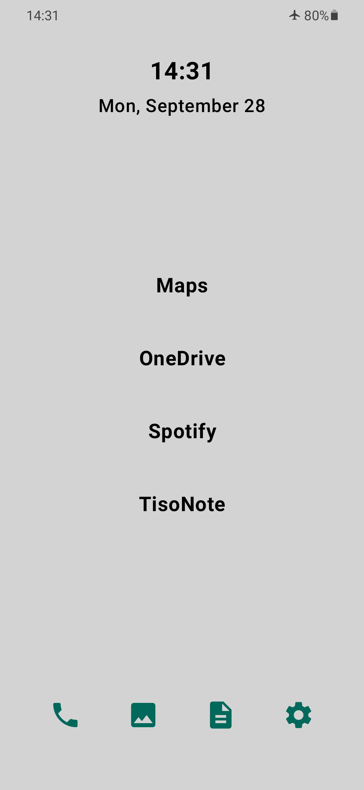
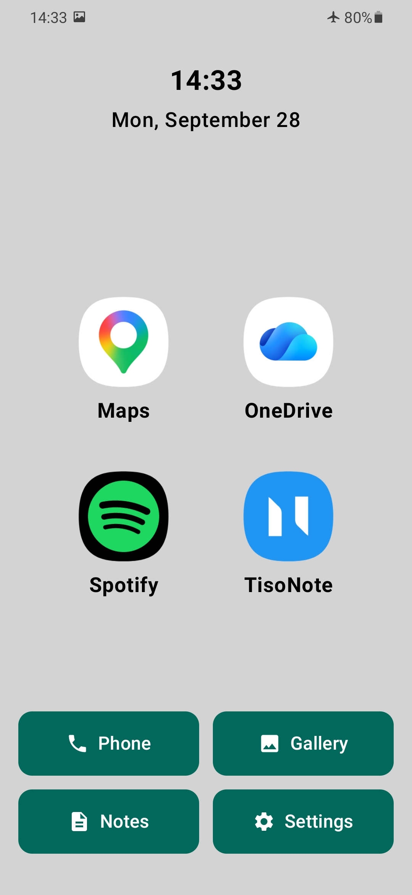
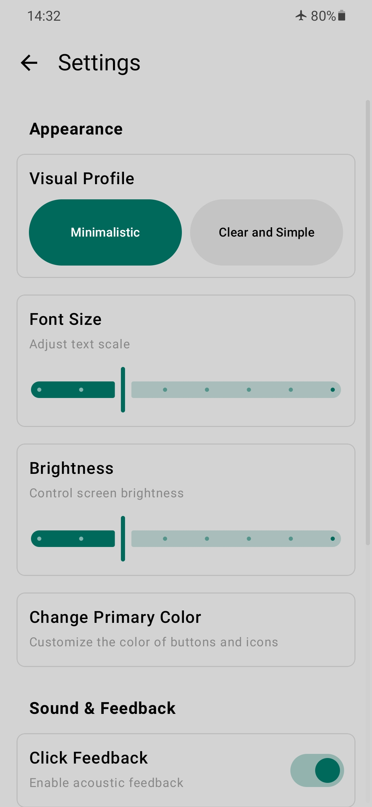
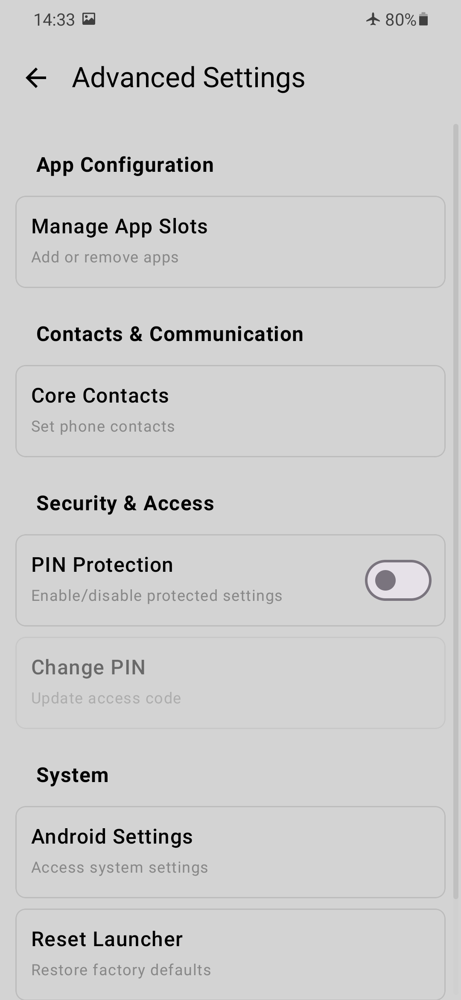

# Minimal Personal OS

<p align="right">
  <b>🇬🇧 English</b> &nbsp;|&nbsp; <a href="README.de.md">🇩🇪 Deutsch</a>
</p>

A minimalist Android launcher and core application suite designed for low cognitive load, effortless accessibility, and intentional digital well-being.

Developed as a Master's project by **Matthias Gerhard** and **Max Timur Sönmez**.

---

Traditional smartphone simplification solutions for older adults or individuals with low digital literacy often either drastically strip away functionality or bury accessibility aids deep inside settings menus—requiring the exact technical expertise the target audience lacks. **Minimal Personal OS** replaces the stock Android home screen while preserving core capabilities. It adapts to the user's growing familiarity through two distinct visual profiles.

## Features

- **Launcher**: Full-fledged Android home screen with customizable shortcut tiles.
- **Setup Wizard**: Guided, barrier-free first-time onboarding.
- **Two Visual Profiles**:
  - *Minimalistic*: Purely text-driven, distraction-free interface.
  - *Clear and Simple*: High-contrast large icons with clearly labeled touch targets.
- **Adaptive Ergonomics**: Adjustable typography scale, high-contrast color palettes, universal brightness slider, and auditory touch feedback.
- **Phone & Contacts**: Streamlined dialer with quick-dial contact management.
- **Notes**: Lightweight note-taking with local database persistence.
- **Gallery**: Clean photo and video browser.
- **Protected Settings**: PIN-secured configuration area allowing caregivers or relatives to configure device parameters without risk of accidental misconfiguration in daily use.

## User Interface

The same home screen across both profiles: The *Minimalistic* profile focuses on clean typography and a lean status bar, while *Clear and Simple* provides prominent icons and labeled buttons for the four primary actions.

| Profile *Minimalistic* | Profile *Clear and Simple* |
| --- | --- |
|  |  |

Settings follow a two-tier model: everyday settings (profile switch, font size, brightness) are freely accessible, while core configurations (app slots, contacts, PIN setup) require authentication.

| Open Settings | Protected Settings |
| --- | --- |
|  |  |

## Technical Overview

Built with Kotlin and Jetpack Compose following modern MVVM architecture with a single-activity design. In-app navigation is managed via a type-safe `Screen` enum in `MainApp.kt`.

```text
app/src/main/java/com/tisosoft/minimalpersonalos/
├── MainActivity.kt          Entry point
├── ui/
│   ├── MainApp.kt           Navigation, global theming, font scaling
│   ├── screens/             Launcher, Phone, Notes, Gallery, Settings,
│   │                        ProtectedSettings, SetupWizard
│   ├── components/          Reusable dialogs and UI building blocks
│   └── theme/               Colors, typography, theme definitions
├── viewmodel/               Gallery, Notes, Phone, Settings
├── data/                    App, Contact, Media, Settings repositories
│   └── notes/               Room database for notes
├── model/                   AppInfo, MediaItem, VisualProfile
└── utils/                   Brightness, audio, time utilities
```

Configuration and user preferences persist via `SharedPreferences`, notes in a local SQLite database using Room. Dedicated repository layers abstract Android system services such as `PackageManager`, `ContactsProvider`, and `MediaStore`.

### Build Specifications

| Component | Target / Version |
| --- | --- |
| Language | Kotlin 2.4.10 |
| UI Toolkit | Jetpack Compose (BOM 2026.08.00) |
| minSdk / targetSdk | 29 (Android 10) / 37 |
| JVM Target | Java 17 |
| Gradle / AGP | 9.7.0 / 9.2.1 |
| Persistence | Room 2.8.4 with KSP |
| Image Loading | Coil 3.5.0 |

## Building & Installation

Requires Android Studio with JDK 17+.

```bash
./gradlew assembleDebug
./gradlew installDebug
```

The application registers itself as a home launcher (`android.intent.category.HOME`). After installation, select Minimal Personal OS as your default launcher in the Android system settings.

Required permissions include Contacts, Phone/Dialer, Media Access, and System Settings write permissions (for universal brightness adjustment).

## License

This project is licensed under the [MIT License](LICENSE).
